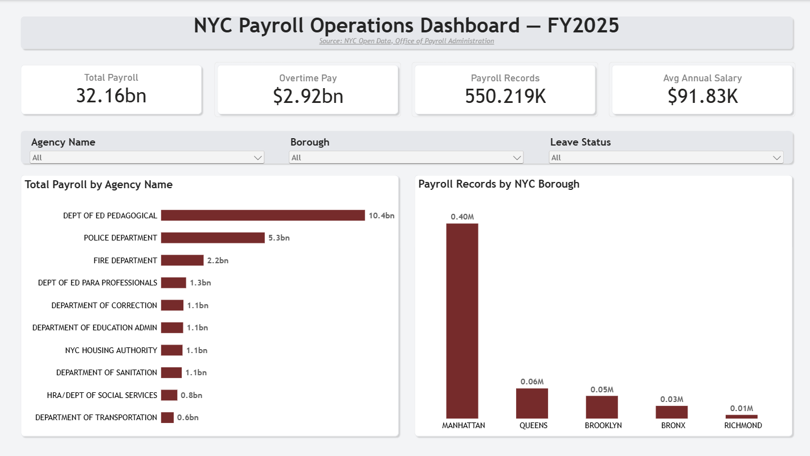
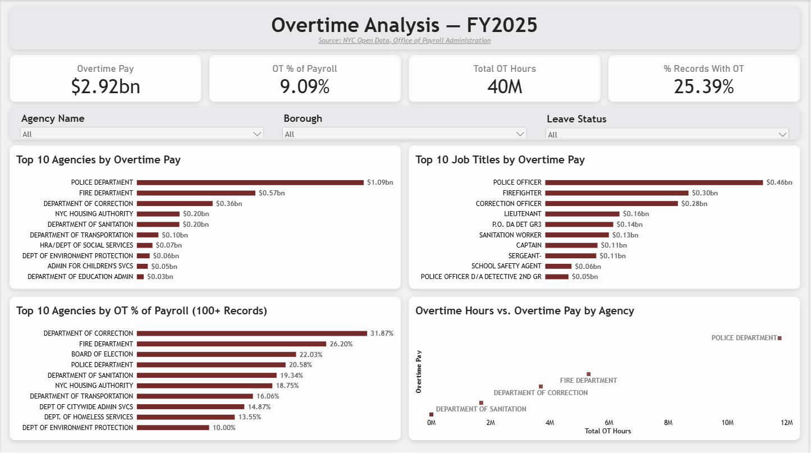
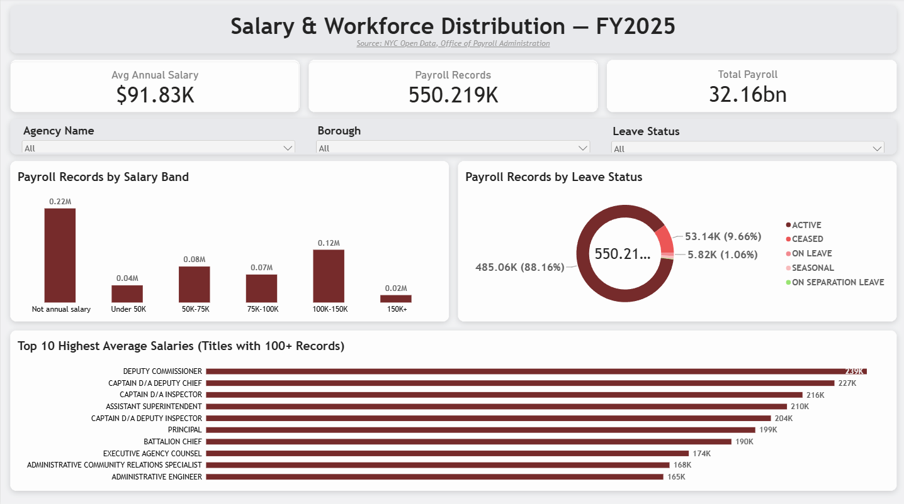

# NYC Payroll Operations Dashboard (FY2025) — Power BI

> A Power BI dashboard, connected to NYC's official open payroll data, that answers the questions a Payroll / HCM operations team actually asks: **Where does the money go? Who works overtime? How is pay distributed? Who is in the workforce?**

**Tools:** Power BI · Power Query (M) · DAX · OData  **Data:** NYC Open Data, Citywide Payroll (FY2025), about 550K records  **Data connection:** live link to the official API (refreshable)

---

## 1. Project Overview

**The problem:** Payroll is usually an organisation's largest cost, and overtime is its most volatile part. Payroll and HCM teams are repeatedly asked three things: *what are we spending, where is overtime getting out of control, and how is pay structured?* Answering these from a raw table of 550K rows is slow and error-prone.

**What this project does:** It connects to the official NYC payroll dataset, cleans it, and turns it into a three-page interactive dashboard so those questions can be answered in seconds.

**Why I built it:** To demonstrate the end-to-end skills of a payroll / HCM data analyst on real, public-sector data: sourcing, cleaning, modelling, measure design, visual design and documentation. Nothing in it is invented or simulated.

---

## 2. Business Questions This Dashboard Answers

*Why this table comes first:* a dashboard is only useful if it answers real questions. Every visual was chosen to answer one of these.

| # | Business question | Where it is answered | Why the question matters | What the data shows |
|---|---|---|---|---|
| 1 | How much did NYC spend on payroll, and how large is the workforce? | Page 1 KPI cards | Headline cost and size frame every other number. | $32.16B total payroll across about 550K records |
| 2 | Which agencies drive payroll cost? | Page 1, Total Payroll by Agency | Shows where budget is concentrated and where to look first. | Dept of Education (Pedagogical) is about 32% of total payroll |
| 3 | Where is the workforce located? | Page 1, Records by NYC Borough | Adds geographic context to workforce size. | Manhattan holds the large majority of records |
| 4 | How much overtime are we paying, and is it a big share of cost? | Page 2 KPI cards | Overtime is the most volatile and controllable pay component. | $2.92B overtime, 9.09% of payroll, about 25% of records include overtime |
| 5 | Which agencies and job titles generate the most overtime cost? | Page 2, Top 10 Agencies and Top 10 Job Titles | Tells managers exactly where overtime dollars go. | Police, Fire and Correction are about 69% of overtime; Police Officer is the top title |
| 6 | Which agencies are most *dependent* on overtime, regardless of size? | Page 2, OT % of Payroll by Agency | Dollar totals favour large agencies; a percentage compares fairly and can flag staffing gaps. | Correction (31.87%) and Fire (26.20%) are most dependent |
| 7 | Does more overtime *time* mean more overtime *cost*? | Page 2, OT Hours vs. OT Pay scatter | Checks whether cost grows in step with hours, or whether rates differ by agency. | Cost rises with hours; Police sits far out on both |
| 8 | How is pay distributed across the workforce? | Page 3, Records by Salary Band | An average hides the shape of pay; a distribution shows it. | 100K-150K is the largest band among annual-salaried staff |
| 9 | Who is actually in the data: active, ceased or on leave? | Page 3, Records by Leave Status | Prevents overstating the working headcount. | About 88% active, about 10% ceased |
| 10 | Which roles sit at the top of the pay scale? | Page 3, Top 10 Highest Average Salaries | Supports compensation planning and pay-structure discussions. | Deputy Commissioner and senior uniformed ranks lead |

---

## 3. Live Data Connection

**What "live" means here:** The report is not built from a downloaded CSV. It queries NYC Open Data's official OData API directly. Clicking **Refresh** in Power BI re-queries the source and loads the latest published records, with no manual download or copy-paste.

**Why I did it this way:**
- **Credibility:** the numbers trace to the primary source, and anyone can check them.
- **Reproducibility:** the same query gives the same data to anyone who runs it.
- **Maintainability:** when NYC updates the dataset, the dashboard updates on refresh, and every cleaning step and measure re-runs automatically.
- **Efficiency:** the fiscal-year filter runs on the server, so only the rows needed are downloaded.

**Endpoint used:**
```
https://data.cityofnewyork.us/api/odata/v4/k397-673e?$filter=fiscal_year eq 2025
```

**To analyse a different year:** change `2025` in the query to another fiscal year and refresh.

**Honest limits (what live does *not* mean):**
- It is **refresh-on-demand**, not a real-time stream. Payroll data is published by the City periodically, not second by second.
- The screenshots in this repo are a **snapshot** from the date below, so figures may differ slightly after a refresh.
- Refreshing in Power BI Service on a schedule would need a gateway-free cloud connection and a published workspace; this portfolio version refreshes from Power BI Desktop.

**Snapshot date of screenshots:** *4 November 2026*

---

## 4. Data Source and Scope

- **Dataset:** [Citywide Payroll Data (Fiscal Year)](https://data.cityofnewyork.us/City-Government/Citywide-Payroll-Data-Fiscal-Year-/k397-673e), NYC Open Data, published by the NYC Office of Payroll Administration (OPA).
- **Why this source:** It is an official, public, real payroll dataset. Primary-source data makes the analysis verifiable.
- **Scope: Fiscal Year 2025 only.** *Why:* the full dataset spans many fiscal years and millions of rows. One year keeps Power BI fast and the repo light, and avoids mixing years whose pay rates are not comparable.
- **Privacy:** employee names are not loaded. *Why:* the analysis is about agencies and titles, not individuals, and dropping names follows data-minimisation practice.

### Columns kept (12 of 17)
*Why trim columns:* fewer columns means a smaller, faster model and a cleaner field list for report users.

| Column | Role in the analysis |
|---|---|
| Fiscal Year | Confirms the filter and allows a future multi-year extension. |
| Payroll Number | The agency payroll code on each record; used to count records. |
| Agency Name | Main dimension for cost and overtime comparison. |
| Title Description | Dimension for overtime and salary by job role. |
| Work Location Borough | Geographic slicer and chart. |
| Leave Status as of June 30 | Separates active from ceased or on-leave records. |
| Base Salary | Basis for salary analysis (normalised by Pay Basis). |
| Pay Basis | Needed because base salary is quoted per year, per day or per hour. |
| Regular Hours | Context for regular work effort. |
| Regular Gross Paid | Core measure for regular pay. |
| OT Hours | Overtime effort. |
| Total OT Paid | Overtime cost; the key operational-risk measure. |

---

## 5. Methodology: What I Did and Why

### Step 1 — Load through the OData feed
*Why:* pulls official data directly, supports refresh, and keeps raw data out of the repo.

### Step 2 — Clean and shape in Power Query
*Why in Power Query and not in DAX or visuals:* every step is recorded and repeatable, so the data is cleaned once, at the source, and every visual benefits.

| Transformation | Why |
|---|---|
| Select the 12 needed columns | Smaller model, faster visuals, tidier field list. |
| Set data types | Stops numbers being treated as text, which would break SUM and AVERAGE. |
| Trim spaces and convert text to upper case | Prevents one agency appearing twice from spacing or casing differences. Upper case (not proper case) keeps acronyms like NYC intact. |
| Replace null pay and hours with 0 | Missing pay means none was paid, and nulls would drop rows from calculations. |
| Leave null Base Salary as null | A missing salary is unknown, not zero. Setting it to 0 would drag averages down. |
| Rename columns to business-friendly names | Report users should see "Overtime Pay", not `total_ot_paid`. |
| Add **Annual Salary** (per-annum records only) | Base Salary is quoted per year, day or hour, so averaging them together is meaningless. |
| Add **Salary Band** and **Salary Band Order** | Bands show the distribution; the order column sorts them correctly while keeping labels clean. |
| Add **Has Overtime** flag | Makes "share of records with overtime" simple and fast. |
| Add **Has Negative Pay** flag (do not delete) | Negative amounts are legitimate payroll adjustments. Deleting them would misstate totals, so they are flagged for transparency. |

### Step 3 — Model
A single flat fact table. *Why:* with one fiscal year and one source table, a star schema would add complexity without adding value. If multiple years or a calendar table were added, I would split out Agency and Title dimensions.

### Step 4 — DAX measures
All measures are in [`dax/measures.dax`](dax/measures.dax). *Why measures and not calculated columns:* measures respond to slicers and cross-filtering and don't inflate the model size.

### Step 5 — Dashboard design
*Why a fixed 1920 × 1080 canvas and one grid:* every page uses the same header, KPI row, slicer row and chart panels, so users learn the layout once and the three pages read as one product.

*Why three pages:* each page answers one family of questions, so users don't scan a crowded single page.

*Why slicers (Agency Name, Borough, Leave Status) synced across pages:* a user can filter once and see a consistent story everywhere.

*Why Pay Basis is not a slicer:* Avg Annual Salary is blank for hourly and daily pay, so exposing it would blank the cards and confuse viewers.

---

## 6. Why Each Visual Was Chosen

*Why this section exists:* choosing the right chart for the question is a core analyst skill. Each visual below has a reason, not just a look.

### Page 1: Executive Overview (answers: how big, and where?)
| Visual | Question | Why this visual |
|---|---|---|
| KPI cards: Total Payroll, Overtime Pay, Payroll Records, Avg Annual Salary | How big is the cost and the workforce? | Single numbers read fastest; leaders want the headline first. |
| Bar chart: Total Payroll by Agency (top 10) | Which agencies drive cost? | Long agency names need horizontal bars; sorted, so the biggest is obvious. Top 10 keeps it readable among many agencies. |
| Column chart: Records by NYC Borough | Where are records located? | Five categories compare cleanly as columns. Filtered to the five boroughs, because other locations are tiny and make it unreadable. |

### Page 2: Overtime Analysis (answers: where is overtime, and how risky is it?)
| Visual | Question | Why this visual |
|---|---|---|
| KPI cards: Overtime Pay, OT % of Payroll, Total OT Hours, % Records With OT | How much overtime, how large a share, how widespread? | Gives cost, intensity and prevalence at a glance. |
| Bar: Top 10 Agencies by Overtime Pay | Who generates overtime cost? | Ranks absolute dollars so managers see where the money is. |
| Bar: Top 10 Job Titles by Overtime Pay | Which roles earn the overtime? | Goes one level deeper than agency, to the job that drives cost. |
| Bar: Top 10 Agencies by OT % of Payroll (100+ records) | Who depends on overtime most? | A percentage compares large and small agencies fairly. The 100+ records rule stops tiny agencies from showing misleading percentages. |
| Scatter: OT Hours vs. OT Pay by Agency | Does cost scale with hours? | A scatter shows the relationship between two numbers and exposes outliers like Police. |

### Page 3: Salary and Workforce (answers: how is pay distributed, and who is in the data?)
| Visual | Question | Why this visual |
|---|---|---|
| KPI cards: Avg Annual Salary, Payroll Records, Total Payroll | What is the pay level, size and cost? | The three headline numbers for a workforce view. |
| Column: Records by Salary Band | How is pay distributed? | Ordered ranges read like a histogram and show the shape that an average hides. |
| Donut: Records by Leave Status | Who is active, ceased or on leave? | Few categories and a share-of-whole question suit a donut. |
| Bar: Top 10 Highest Average Salaries (100+ records) | Which roles sit at the top of the pay scale? | Ranked bars for long job titles. A minimum record count stops one-person titles from distorting the ranking. |

---

## 7. Key Metrics

| Metric | Definition | Why defined this way |
|---|---|---|
| Payroll Records | Count of rows | One row is one employee-title-agency record, so this approximates headcount (see Limitations). |
| Total Payroll | Regular Gross Paid + Total OT Paid | Shows the cost actually paid from these two fields. |
| Overtime Pay | Sum of Total OT Paid | The primary operational-risk measure. |
| Avg Annual Salary | Average Annual Salary (per-annum records only) | Avoids mixing hourly, daily and annual rates. |
| OT % of Payroll | Overtime Pay ÷ Total Payroll | Normalises overtime so agencies of any size can be compared. |
| % Records With OT | Records with overtime ÷ all records | Shows how widespread overtime is. |
| Avg Salary (100+ Records) | Average annual salary, shown only for titles with 100+ annual-salaried records | A minimum sample size stops tiny titles from dominating a Top 10. A plain filter on record count clashes with Top N and empties the chart, so a measure is used instead. |

---

## 8. Key Insights

*Why this section exists:* a dashboard shows data; insights show judgement. Figures are read from the dashboard and rounded, so they are approximate.

1. **Education is the largest cost.** Dept of Education (Pedagogical) is about 32% of the $32.16B total payroll, and the three education agencies together are about 40%.
2. **Public safety drives overtime.** Police, Fire and Correction account for about 69% of the $2.92B overtime bill, and Police alone for about 37% ($1.09B). Police Officer is the largest overtime job title ($0.46B).
3. **Overtime dollars and overtime dependence tell different stories.** Correction (31.87%) and Fire (26.20%) have the highest overtime share of payroll, higher than Police (20.58%), whose regular payroll is much larger.
4. **Overtime is widespread.** It is 9.09% of total payroll, about 25% of records include some overtime, and the workforce logged about 40M overtime hours, roughly $73 per hour.
5. **Pay is concentrated in the middle bands.** Among annual-salaried records, 100K-150K is the largest band (about 36%), and the average annual salary is about $91.8K. About 40% of records are not on an annual basis.
6. **Most records are active.** About 88% are active staff and about 10% are ceased, so payroll records are not the same as current headcount.

**Recommendation:** Review staffing and scheduling in the highest overtime-share agencies (Correction, Fire, Board of Election) first, since a high overtime share can signal understaffing or coverage gaps.

---

## 9. Dashboard Preview

*Why screenshots:* a reviewer should see the result in seconds without installing Power BI.





---

## 10. Limitations and Assumptions

*Why state these:* honest limitations show analytical maturity and prevent misreading.

- **One row is not always one person.** The same person can appear in several rows (different agencies or titles), so Payroll Records approximates headcount rather than equals it.
- **Fiscal Year 2025 only.** Findings do not show trends over time.
- **About 40% of records are not on an annual basis** (per day, per hour or prorated), so salary analysis covers annual-salaried records only.
- **Leave Status is a snapshot** as of June 30, not across the full year.
- **Negative values** are payroll adjustments and were kept.
- **Total Payroll excludes "Other Pay"**, because that column was not among the 12 kept fields.
- **The borough chart shows the five NYC boroughs only.** Records with other work locations (for example upstate or blank) are excluded from that chart but included in totals.
- **The Top 10 salary chart only includes titles with 100+ annual-salaried records**, to avoid misleading averages from very small groups.
- **Live data is refresh-on-demand**, not real-time (see Section 3).

---

## 11. Repository Structure

```
nyc-payroll-workforce-analysis/
├── README.md                  # project story, method and insights
├── powerbi/
│   └── NYC_Payroll_Dashboard.pbix
├── dax/
│   └── measures.dax           # every DAX measure, version-controlled
├── powerquery/
│   └── transformations.m      # the M code of the cleaning steps
├── images/                    # dashboard screenshots used in this README
├── docs/
│   └── data_dictionary.md     # description of every column
└── .gitignore
```

*Why this structure:* a reviewer can find the method, code and visuals without hunting. DAX and M live in text files because .pbix files are binary and cannot be read or compared on GitHub.

---

## 12. How to Reproduce and Refresh

1. Open Power BI Desktop → **Get Data → OData Feed** and paste the endpoint from Section 3.
2. Open **Transform Data → Advanced Editor** and paste the code from `powerquery/transformations.m`. *Why:* this rebuilds every cleaning step exactly.
3. Add the measures from `dax/measures.dax`. *Why:* the visuals depend on them.
4. Set **Salary Band** to sort by **Salary Band Order**. *Why:* it keeps bands in salary order.
5. Or simply open `powerbi/NYC_Payroll_Dashboard.pbix`, then click **Home → Refresh** to pull the latest data from the official source.

---

## 13. Skills Demonstrated

Power BI · Power Query (M) · DAX · OData / API connection · Data cleaning · Data modelling · KPI and measure design · Chart selection · Payroll / HCM analytics · Dashboard storytelling · Documentation

---

## 14. Author

**Your Name** · Sayyed Hamza

*Data © City of New York, used under NYC Open Data terms. This is an independent portfolio project and is not affiliated with the City of New York.*
