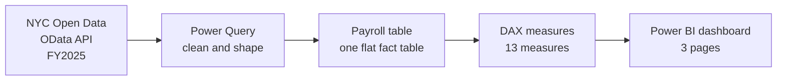

# NYC Payroll & Workforce Analysis — Power BI Dashboard


**A three-page Power BI dashboard, connected to the official NYC Open Data API, that answers the questions a payroll / HCM team asks: where does the money go, who works overtime, how is pay distributed, and who is in the workforce.**


---

## Contents

[Overview](#overview) · [At a Glance](#at-a-glance) · [Business Questions](#business-questions) · [Quick Start](#quick-start) · [How It Works](#how-it-works) · [Live Data Connection](#live-data-connection) · [Data Source and Scope](#data-source-and-scope) · [Data Preparation Decisions](#data-preparation-decisions) · [Metrics](#metrics) · [Dashboard Walkthrough](#dashboard-walkthrough) · [Key Insights](#key-insights) · [Limitations](#limitations) · [Repository Structure](#repository-structure) · [Roadmap](#roadmap) · [Skills Demonstrated](#skills-demonstrated) · [Author](#author)

---

## Overview

**The problem.** Payroll is usually an organisation's largest cost, and overtime is its most volatile part. Payroll and HCM teams are repeatedly asked what is being spent, where overtime is out of control, and how pay is structured. Answering that from a raw table of 550,000 rows is slow and error-prone.

**The solution.** This project connects directly to NYC's official payroll dataset, cleans it, and presents it as an interactive three-page dashboard, so those questions can be answered in seconds.

**Why I built it.** To demonstrate the full workflow of a payroll / HCM data analyst on real public-sector data: sourcing, cleaning, modelling, measure design, chart selection and documentation. Nothing here is simulated or invented.

---

## At a Glance

| Total payroll | Overtime pay | Payroll records | Avg annual salary |
|:---:|:---:|:---:|:---:|
| **$32.16B** | **$2.92B** (9.09% of payroll) | **550,219** | **$91.8K** |

- **Education is the largest cost:** Dept of Education (Pedagogical) is about 32% of total payroll.
- **Public safety drives overtime:** Police, Fire and Correction are about 69% of overtime pay.
- **Dependence differs from dollars:** Correction (31.87%) and Fire (26.20%) lean on overtime more than Police (20.58%).

**Data snapshot:** *4 November 2026*  ·  **Source:** [NYC Open Data, Citywide Payroll](https://data.cityofnewyork.us/City-Government/Citywide-Payroll-Data-Fiscal-Year-/k397-673e), Fiscal Year 2025

---

## Business Questions

*Why this table comes first:* a dashboard is only useful if it answers real questions, and every visual was chosen to answer one of these.

| # | Question | Answered by | Why it matters |
|---|---|---|---|
| 1 | How much did NYC spend on payroll, and how large is the workforce? | Page 1 KPI cards | Headline cost and size frame every other number. |
| 2 | Which agencies drive payroll cost? | Page 1, Payroll by Agency | Shows where budget is concentrated. |
| 3 | Where is the workforce located? | Page 1, Records by Borough | Adds geographic context. |
| 4 | How much overtime is paid, and how large is its share? | Page 2 KPI cards | Overtime is the most volatile, controllable cost. |
| 5 | Which agencies and job titles generate the most overtime cost? | Page 2, Top 10 Agencies and Titles | Shows exactly where overtime dollars go. |
| 6 | Which agencies depend most on overtime, regardless of size? | Page 2, OT % of Payroll | Percentages compare fairly; dollars favour big agencies. |
| 7 | Does more overtime time mean more overtime cost? | Page 2, OT Hours vs. OT Pay | Exposes differences in rate and outliers. |
| 8 | How is pay distributed? | Page 3, Records by Salary Band | An average hides the shape of pay. |
| 9 | Who is active, ceased or on leave? | Page 3, Records by Leave Status | Prevents overstating working headcount. |
| 10 | Which roles sit at the top of the pay scale? | Page 3, Top 10 Average Salaries | Supports compensation planning. |

---

## Quick Start

**Requirements:** [Power BI Desktop](https://powerbi.microsoft.com/desktop/) (free, Windows) and an internet connection.

**Fastest option, just look:** scroll to the [Dashboard Walkthrough](#dashboard-walkthrough). The screenshots show every page.

**Open and refresh (about 2 minutes):**
1. Download `powerbi/NYC_Payroll_Dashboard.pbix` and open it in Power BI Desktop.
2. Click **Home → Refresh**. *Why:* this pulls the latest published data from the official source.
3. If asked for credentials, choose **Anonymous**. *Why:* the dataset is public and needs no login.

**Rebuild from scratch (about 15 minutes):**
1. **Get Data → OData Feed**, then paste the endpoint from [Live Data Connection](#live-data-connection).
2. Open **Transform Data → Advanced Editor** and paste [`powerquery/transformations.m`](powerquery/transformations.m). *Why:* it recreates every cleaning step exactly.
3. Name the query `Payroll`, then **Close & Apply**.
4. Add the measures from [`dax/measures.dax`](dax/measures.dax), one at a time. *Why:* the visuals depend on them.
5. Set **Salary Band** to sort by **Salary Band Order**. *Why:* it keeps the bands in salary order.

---

## How It Works

*Why a diagram:* the pipeline is easier to grasp visually than in prose.



---

## Live Data Connection

**What "live" means here.** The report is not built from a downloaded CSV. It queries NYC Open Data's official OData API directly, so clicking **Refresh** in Power BI re-queries the source and loads the latest published records.

**Endpoint**
```
https://data.cityofnewyork.us/api/odata/v4/k397-673e?$filter=fiscal_year eq 2025
```

**Why connect this way**
- **Credibility:** every number traces to the primary source and can be checked.
- **Reproducibility:** anyone running the same query gets the same data.
- **Maintainability:** when the City updates the dataset, a refresh re-runs every cleaning step and measure automatically.
- **Efficiency:** the year filter runs on the server, so only the needed rows are downloaded.

**To analyse another year:** change `2025` in the query to a different fiscal year and refresh.

**What live does not mean**
- It is refresh-on-demand, not a real-time stream. The City publishes payroll data periodically.
- Screenshots in this repo are a snapshot from the date shown in [At a Glance](#at-a-glance), so figures may differ slightly after a refresh.
- Scheduled refresh would need the report published to Power BI Service. This portfolio version refreshes manually from Power BI Desktop.

---

## Data Source and Scope

| | |
|---|---|
| **Dataset** | [Citywide Payroll Data (Fiscal Year)](https://data.cityofnewyork.us/City-Government/Citywide-Payroll-Data-Fiscal-Year-/k397-673e), NYC Office of Payroll Administration |
| **Scope** | Fiscal Year 2025, about 550K records |
| **Grain** | One row per employee-title-agency payroll record |
| **Columns kept** | 12 of 17, listed in the [data dictionary](docs/data_dictionary.md) |

- **Why an official source:** primary-source data makes the analysis verifiable.
- **Why one fiscal year:** the full dataset spans many years and millions of rows. One year keeps Power BI fast and avoids mixing years whose pay rates are not comparable.
- **Why only 12 columns:** a smaller model is faster, and the field list stays clean for report users.
- **Why no names:** the analysis is about agencies and titles, not individuals, which follows data-minimisation practice.

---

## Data Preparation Decisions

*Why a table of decisions:* these choices change the numbers, so each one is stated with its reason. The full code is in [`powerquery/transformations.m`](powerquery/transformations.m).

| Decision | Why |
|---|---|
| Clean in Power Query, not in DAX or visuals | Every step is recorded and repeatable, and every visual benefits. |
| Set explicit data types | Stops numbers being treated as text, which breaks SUM and AVERAGE. |
| Trim text and convert to upper case | Prevents one agency appearing twice from spacing or casing. Upper case keeps acronyms like NYC intact. |
| Null pay and hours become 0 | Missing pay means none was paid, and nulls would drop rows from calculations. |
| Null base salary stays null | A missing salary is unknown, not zero, and 0 would drag averages down. |
| Create **Annual Salary** from per-annum records only | Base salary is quoted per year, day or hour, so averaging them together is meaningless. |
| Create **Salary Band** plus a separate **Salary Band Order** | Bands show the pay distribution, and the order column sorts them while keeping labels clean. |
| Flag negative pay, do not delete it | Negatives are legitimate payroll adjustments, and deleting them would misstate totals. |
| Single flat table, no star schema | One year and one source table, so a star schema would add complexity without value. |

---

## Metrics

*Why measures and not calculated columns:* measures respond to slicers and cross-filtering and don't add to model size. All 13 are in [`dax/measures.dax`](dax/measures.dax). The key ones:

| Metric | Definition | Why defined this way |
|---|---|---|
| Total Payroll | Regular Gross Paid + Total OT Paid | The cost actually paid from the loaded fields. |
| Overtime Pay | Sum of Total OT Paid | The main operational-risk measure. |
| OT % of Payroll | Overtime Pay ÷ Total Payroll | Normalises overtime so any agency size can be compared. |
| % Records With OT | Records with overtime ÷ all records | Shows how widespread overtime is. |
| Avg Annual Salary | Average Annual Salary (per-annum records) | Avoids mixing hourly, daily and annual rates. |
| Avg Salary (100+ Records) | Average annual salary, shown only for titles with 100+ annual-salaried records | A minimum sample size stops tiny titles dominating a Top 10. A plain filter clashes with Top N and empties the chart, so a measure is used. |
| Payroll Records | Row count | Approximates headcount (see [Limitations](#limitations)). |

---

## Dashboard Walkthrough

*Why three pages:* each page answers one family of questions, so no page is crowded. All pages share one 1920 × 1080 grid, so users learn the layout once. Slicers (Agency, Borough, Leave Status) are synced, so a user filters once and sees a consistent story. Pay Basis is deliberately not a slicer, because Avg Annual Salary is blank for hourly and daily pay and would confuse viewers.

### Page 1: Executive Overview
*How big is the cost, and where does it sit?*


| Visual | Why this visual |
|---|---|
| 4 KPI cards | Single numbers read fastest, and leaders want the headline first. |
| Bar: Payroll by Agency, top 10 | Long agency names need horizontal bars, and a top 10 keeps it readable. |
| Column: Records by NYC Borough | Five categories compare cleanly. Other work locations are excluded because they are tiny. |

### Page 2: Overtime Analysis
*Where is overtime concentrated, and who depends on it most?*


| Visual | Why this visual |
|---|---|
| 4 KPI cards | Give cost, intensity, volume and prevalence at a glance. |
| Bar: Top 10 Agencies by Overtime Pay | Ranks absolute dollars so managers see where the money is. |
| Bar: Top 10 Job Titles by Overtime Pay | Goes one level deeper, to the role that drives the cost. |
| Bar: Top 10 Agencies by OT % of Payroll | A percentage compares large and small agencies fairly. A 100+ records rule removes misleading tiny agencies. |
| Scatter: OT Hours vs. OT Pay | Shows whether cost scales with hours and exposes outliers. |

### Page 3: Salary and Workforce
*How is pay distributed, and who is in the data?*


| Visual | Why this visual |
|---|---|
| 3 KPI cards | Pay level, size and cost: the headline numbers for a workforce view. |
| Column: Records by Salary Band | Ordered ranges read like a histogram and reveal the shape an average hides. |
| Donut: Records by Leave Status | A few categories and a share-of-whole question suit a donut. |
| Bar: Top 10 Highest Average Salaries | Ranked bars suit long titles. A minimum record count stops one-person titles distorting the ranking. |

---

## Key Insights

*Figures are read from the dashboard and rounded, so they are approximate.*

1. **Education is the largest cost.** Dept of Education (Pedagogical) is about 32% of the $32.16B total, and the three education agencies together about 40%.
2. **Public safety drives overtime.** Police, Fire and Correction account for about 69% of the $2.92B overtime bill, Police alone for about 37% ($1.09B). Police Officer is the largest overtime job title ($0.46B).
3. **Overtime dollars and overtime dependence tell different stories.** Correction (31.87%) and Fire (26.20%) have the highest overtime share of payroll, higher than Police (20.58%), whose regular payroll is much larger.
4. **Overtime is widespread.** It is 9.09% of payroll, about 25% of records include some overtime, and about 40M overtime hours were logged, roughly $73 per hour.
5. **Pay is concentrated in the middle bands.** Among annual-salaried records, 100K-150K is the largest band (about 36%). About 40% of records are not on an annual basis.
6. **Most records are active.** About 88% are active staff and about 10% are ceased, so payroll records are not the same as current headcount.

**Recommendation:** review staffing and scheduling first in the agencies with the highest overtime share (Correction, Fire, Board of Election), since a high share can signal understaffing or coverage gaps.

---

## Limitations

*Why state these:* honest limitations prevent misreading and show analytical maturity.

- **One row is not always one person.** A person can appear in several rows (different agencies or titles), so Payroll Records approximates headcount.
- **One fiscal year only.** The findings do not show trends over time.
- **About 40% of records are not annual** (per day, per hour or prorated), so salary analysis covers annual-salaried records only.
- **Leave Status is a snapshot** as of June 30, not across the whole year.
- **Total Payroll excludes "Other Pay"**, which was not among the 12 columns kept.
- **The borough chart shows the five NYC boroughs only.** Other work locations (upstate or blank) are excluded from that chart but included in totals.
- **The Top 10 salary chart only includes titles with 100+ annual-salaried records**, to avoid misleading averages from tiny groups.
- **Negative pay values were kept**, because they are payroll adjustments.

---

## Repository Structure

```
nyc-payroll-workforce-analysis/
├── README.md                    project overview, method and insights
├── powerbi/
│   └── NYC_Payroll_Dashboard.pbix
├── powerquery/
│   └── transformations.m        every cleaning step
├── dax/
│   └── measures.dax             all 13 measures
├── docs/
│   └── data_dictionary.md       every field, source and derived
├── images/                      dashboard screenshots
└── .gitignore
```

*Why this layout:* a reviewer can find the method, code and visuals without hunting. DAX and M live in text files because `.pbix` is binary and cannot be read or compared on GitHub.

---

## Roadmap

*Why list these:* they show where the project would go next, and they are ideas, not claims.

- Add earlier fiscal years to show payroll and overtime trends over time.
- Load the "Other Pay" column so total compensation is complete.
- Split into Agency and Title dimension tables once multiple years are added.
- Publish to Power BI Service and set up scheduled refresh.

---

## Skills Demonstrated

Power BI · Power Query (M) · DAX · OData / API connection · Data cleaning · Data modelling · KPI and measure design · Chart selection · Payroll / HCM analytics · Dashboard storytelling · Technical documentation

---

## Author

**Your Name** · Sayyed Hamza


*Data © City of New York, used under NYC Open Data terms. This is an independent portfolio project and is not affiliated with the City of New York.*
